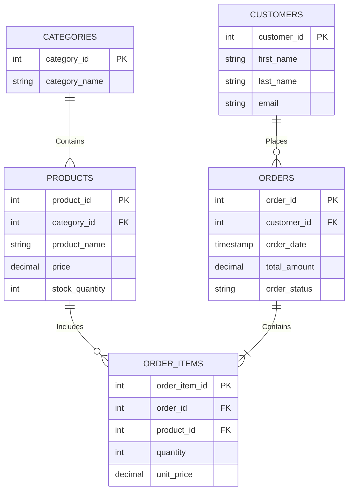

# Portfolio 1: Database Design and Modelling - RanGo E-commerce

## 1. Case Study Description
* **Organisation Name / Scenario:** RanGo (Online E-commerce Platform)
* **Nature of Business:** A digital e-commerce marketplace enabling customers to browse product inventories, manage shopping carts, place online orders, process payments, and track shipments.
* **Database Users:** Customers (browse and buy), Warehouse Staff (update stock and fulfillment status), and System Administrators (manage users and system configuration).
* **Major Data Stored:** Customers, Categories, Products, Orders, Order Items, Payments, and Deliveries.
* **Key Operations:** Registering customer accounts, updating product stock quantities, placing orders, executing transactions, and retrieving order history.  

## 2. Entity-Relationship (ER) Diagram
Below is the Entity-Relationship Diagram for the RanGo database:

## 3. Relational Schema Definition
[
The conceptual ER model is translated into the following logical relational schema, detailing all tables, columns, data types, and constraints:
1.	Customers Table: Stores registered user profile details.
•	Customer id: INT (Primary Key)
•	First name: VARCHAR(50) (NOT NULL)
•	Last name: VARCHAR(50) (NOT NULL)
•	Email: VARCHAR(100) (UNIQUE, NOT NULL)
•	Created at: TIMESTAMP (DEFAULT CURRENT_TIMESTAMP)

2.	Categories Table: Organizes products into logical groups.
•	Category id: INT (Primary Key)
•	Category name: VARCHAR(50) (NOT NULL)

3.	Products Table: Stores the items available for sale in the marketplace.
•	Product id: INT (Primary Key)
•	Category id: INT (Foreign Key references Categories.category_id)
•	Product name: VARCHAR(100) (NOT NULL)
•	Price: DECIMAL(10,2) (NOT NULL)
•	Stock quantity: INT (NOT NULL, CHECK >= 0)

4.	Orders Table: Tracks high-level orders placed by customers.
•	Order id: INT (Primary Key)
•	Customer id: INT (Foreign Key references Customers.customer_id)
•	Order date: TIMESTAMP (DEFAULT CURRENT_TIMESTAMP)
•	Total amount: DECIMAL(10,2) (NOT NULL)
•	Order status: VARCHAR(20) (DEFAULT 'Pending')

5. Order Items Table: Resolves the many-to-many relationship between orders and products.
•	Order item id: INT (Primary Key)
•	Order id: INT (Foreign Key references Orders.order_id)
•	Product id: INT (Foreign Key references Products.product_id)
•	Quantity: INT (NOT NULL, CHECK > 0)
•	Unit price: DECIMAL(10,2) (NOT NULL)
]

