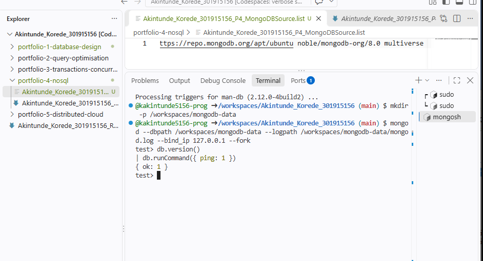

# MongoDB setup

MongoDB runs in the existing Ubuntu Codespace, alongside PostgreSQL.
The server version is 8.0.34. Its data folder is /workspaces/mongodb-data, outside the repository. Connections use 127.0.0.1; port forwarding is off.

## Start and connect

    mongod --dbpath /workspaces/mongodb-data --logpath /workspaces/mongodb-data/mongod.log --fork
    mongosh "mongodb://127.0.0.1:27017"

## Connection check

db.version() returns 8.0.34 and db.runCommand({ ping: 1 }) returns { ok: 1 }.

## Reference

[MongoDB Ubuntu installation guide](https://www.mongodb.com/docs/v8.0/tutorial/install-mongodb-on-ubuntu/)